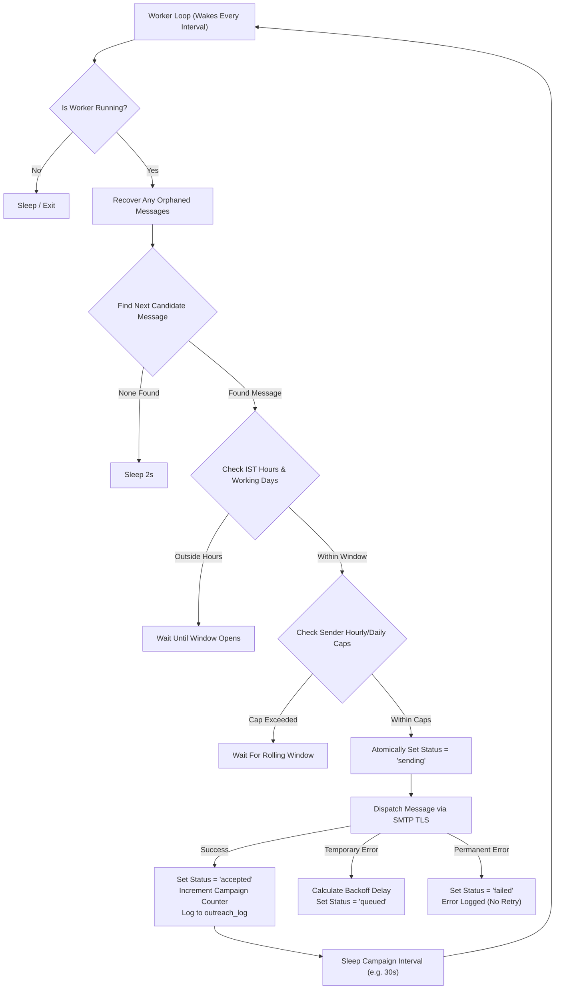

# College Outreach Platform — Technical Operations Runbook

A comprehensive technical manual for systems engineers, technical leads, and DevOps operators responsible for deploying, maintaining, and troubleshooting the Delhi-NCR College Outreach Platform.

---

## 🏛️ System Architecture & Stack

- **Runtime**: Python 3.10+ (Standard Library: `http.server`, `sqlite3`, `smtplib`, `ssl`, `email`, `threading`).
- **Database Engine**: Embedded SQLite 3 with Write-Ahead Logging (`WAL` mode) and enforced Foreign Keys.
- **Frontend**: Zero-dependency vanilla ES6+ JavaScript, Semantic HTML5, and responsive CSS3.
- **Port & Binding**: `http://127.0.0.1:5050` (Localhost binding only).
- **Timezone Standard**: India Standard Time (`IST`, `Asia/Kolkata`, UTC+05:30).

---

## 🔐 Security Architecture & Credential Management

### 1. In-Memory Session Password Policy
To ensure compliance with corporate data protection standards:
- **Zero Plaintext Storage**: The sender's SMTP password or App Password is **never saved to the SQLite database**, never written to `settings.json`, and never logged to stdout/stderr.
- **Volatile Storage**: The credential is stored only in an in-memory dictionary (`_SESSION_CREDENTIALS` in `campaign_queue.py`) protected by a re-entrant thread lock (`threading.Lock()`).
- **Process Boundary**: As soon as the Python server process terminates or is restarted, the in-memory password is immediately flushed. Operators are asked to enter their password only when launching or resuming campaigns.

### 2. Google Workspace & Gmail App Password Setup
Modern Google Workspace and Gmail accounts require an **App Password** for SMTP access because "Less Secure Apps" was permanently deprecated.

**How to generate an App Password:**
1. Log into your Google Account: [https://myaccount.google.com/](https://myaccount.google.com/)
2. Navigate to **Security** -> **2-Step Verification** (must be enabled).
3. Scroll to the bottom and select **App Passwords** (or search "App Passwords").
4. Under "App name", enter: `College Outreach Platform`.
5. Click **Create**. Google will generate a 16-character code (e.g., `abcd efgh ijkl mnop`).
6. Copy this 16-character password (spaces can be omitted or included) and paste it into the Platform's sender password field.

### 3. Microsoft 365 / Exchange Online Setup
If using Microsoft 365:
- Ensure Authenticated SMTP (`SMTP AUTH`) is enabled on the sender mailbox via the Microsoft 365 Admin Center.
- If Multi-Factor Authentication (MFA) is enforced, create an App Password via the Microsoft Security Info portal.
- Standard Port: `587` with `STARTTLS`.

---

## 🗄️ Database Operations & Schema Reference

The database is located at [`data/directory.sqlite3`](file:///d:/job%20discription/job%20discription/data/directory.sqlite3).

### Table Inventory
1. **`colleges`**: The main directory of institutions:
   - Primary identifier, names, acronyms, city, district, locality, pin code, disciplines, website.
   - Placement cell contact (`TPO_Email`, `Contact_Person`, `TPO_Phone`).
   - Alternative general contact (`Alt_Email`, `Alt_Phone`).
   - Verification metadata (`verification_status`, `source_url`, `date_verified`).
   - Recruitment CRM state (`recruitment_stage`, `assigned_to`, `follow_up_date`, `do_not_contact`).
   - Concurrency control: `version` (integer incremented on every save).
2. **`audit`**: Chronological record of all manual edits, field changes, and record merges.
3. **`imports`**: Audit records of batch CSV uploads.
4. **`outreach_log`**: Permanent historical record of every message dispatched, recipient, subject, and provider status.
5. **`campaigns`**: Master campaign configurations, frozen template snapshots, sending schedules, and rate caps.
6. **`campaign_queue`**: Individual queue entries for every recipient college in a campaign with state tracking.
7. **`email_templates`**: Saved reusable templates with HTML, plain text, and subject lines.
8. **`template_history`**: Version snapshots of templates enabling rollbacks.
9. **`outreach_notes`**: Activity log containing notes, recorded replies, and communication entries for each college.

### SQLite Pragma Settings
Every connection executed by `directory.connect()` and `campaign_queue.connect()` enforces:
```sql
PRAGMA journal_mode = WAL;
PRAGMA foreign_keys = ON;
PRAGMA busy_timeout = 5000;
```

### Backup & Maintenance Procedures

#### 1. Live Backup (Hot Backup)
Because SQLite runs in `WAL` mode, you can safely copy or backup the database without stopping the outreach server:
```powershell
python -c "import sqlite3; src = sqlite3.connect('data/directory.sqlite3'); dst = sqlite3.connect('data/backup_directory.sqlite3'); src.backup(dst); dst.close(); src.close(); print('Backup complete.')"
```

#### 2. Manual Integrity Check
Verify database integrity at any time:
```powershell
python -c "import sqlite3; con = sqlite3.connect('data/directory.sqlite3'); print(con.execute('PRAGMA integrity_check;').fetchall())"
```

---

## ⚙️ Background Worker & Queue Lifecycle

The background worker operates inside `campaign_queue.py` as a single daemon thread (`_WORKER_THREAD`):



### 1. Business Sending Windows (IST)
- **Timezone**: Evaluated strictly using UTC+05:30.
- **Sending Window**: Configurable per campaign (default: `09:00` to `18:00` IST).
- **Working Days**: When enabled, the worker automatically pauses on weekends (Saturday = 5, Sunday = 6 in Python `weekday()`).

### 2. Rolling Rate Caps
- **Hourly Cap**: Queries `campaign_queue` for messages accepted in the last 60 minutes across all campaigns sharing the sender address. If `count >= hourly_cap`, dispatch pauses until the rolling window clears.
- **Daily Cap**: Queries messages accepted since 00:00:00 UTC today.

### 3. Crash Recovery Invariants
In the event of a sudden power loss, system crash, or process termination:
- Function: `campaign_queue.recover_stale_queue_on_startup()`.
- Run automatically every time `dashboard.py` starts up.
- Any message found stuck with `status = 'sending'` is safely converted to `needs_review` with the log note: *"System restarted while message was being dispatched. Verify Sent mail before retrying."*
- The associated parent campaign is transitioned to `paused`.
- This ensures an email is **never accidentally sent twice** to an institution without the operator confirming whether the provider actually delivered it.

---

## 🛠️ Operational Troubleshooting

### Problem 1: Port 5050 is already occupied
**Symptoms**: Server exits on startup with `OSError: [WinError 10048] Only one usage of each socket address is normally permitted`.  
**Resolution**:
Run the included PowerShell script which cleanly terminates any orphaned instance:
```powershell
.\start_dashboard.ps1
```
Or manually find and terminate the process holding port 5050:
```powershell
Get-NetTCPConnection -LocalPort 5050 -State Listen | ForEach-Object { Stop-Process -Id $_.OwningProcess -Force }
```

### Problem 2: Google Workspace SMTP Error `535 5.7.8 Username and Password not accepted`
**Symptoms**: Test email or campaign message fails immediately with code 535.  
**Resolution**:
1. Check that you are using a **16-character App Password**, NOT your personal Google Account login password.
2. Ensure **2-Step Verification** is turned on in your Google Account.
3. If using a Google Workspace domain, verify that the domain administrator has not disabled external SMTP relay.

### Problem 3: Messages stuck in `needs_review`
**Symptoms**: Messages appear in orange on the campaign dashboard.  
**Resolution**:
1. Check your email client's "Sent" folder for the recipient email address.
2. If the email was already delivered, you can leave it or record the outreach manually.
3. If the email was not sent, click **"Retry Failed / Review Messages"** in the campaign panel to re-queue the message.

### Problem 4: Server Health Check
Verify system status via HTTP GET:
```powershell
curl http://127.0.0.1:5050/api/health
```
Expected output:
```json
{
  "status": "ok",
  "application": "medantrik-outreach",
  "version": "phase-7",
  "checks": {
    "settings": "ok",
    "directory": "ok",
    "templates": "ok",
    "campaign_queue": "ok"
  }
}
```
