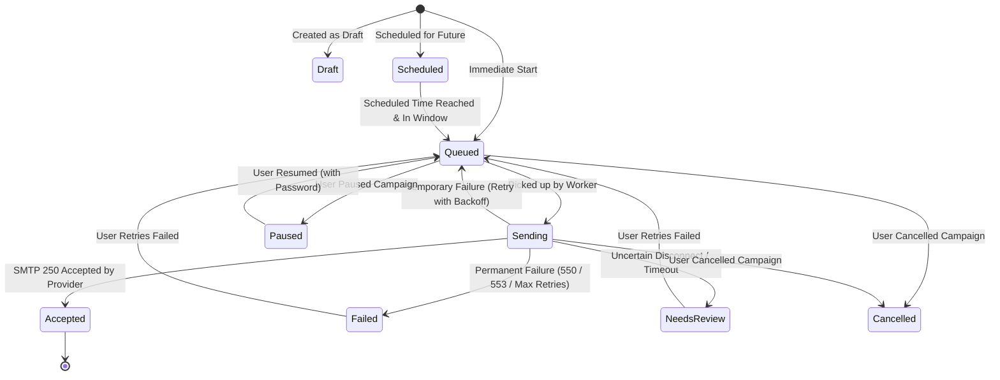

# Phase 5 — Persistent, Staggered Campaign Sending & Background Queue Worker

## 1. Overview & Objective
Phase 5 transforms the College Outreach Platform from a synchronous, browser-locked dispatch script into a resilient, **durable background queue engine**. Sending is completely decoupled from the web browser: users can select any number of colleges, configure rate limits and IST schedules, and trigger a campaign that will continue processing uninterrupted even if the browser is closed or the server restarts.

### Key Capabilities Delivered in Phase 5:
1. **Durable SQLite Queue (`campaign_queue` & `campaigns`)**:
   - Enqueues each personalized outreach message as an individual database record.
   - Enforces unique constraints (`UNIQUE(campaign_id, recipient_email)`) to prevent accidental double-sending.
   - Preserves frozen template snapshots locked to the campaign at creation time.
2. **Autonomous Background Worker Thread**:
   - Runs continuously in the background daemon (`campaign_queue.py`).
   - Polls for due messages, checks rate limits, and dispatches via authenticated SMTP.
   - Auto-starts with `dashboard.py` and terminates gracefully on server shutdown.
3. **India Standard Time (IST) Scheduling & Business Hours**:
   - Time-window gating (e.g. `09:00` to `18:00` IST).
   - Working-day enforcement (Monday through Friday only, pausing automatically over weekends).
   - Future schedule start support (`scheduled_at` ISO datetime).
4. **Multi-Campaign Rate Limiting & Throttling**:
   - Stagger intervals between individual emails (e.g. 30 seconds).
   - Configurable Hourly Cap (e.g. 40/hr) and Daily Cap (e.g. 300/day) enforced across all campaigns sharing the same sender account.
5. **Intelligent Error Handling & Adaptive Retries**:
   - Exponential backoff retry for temporary errors (network timeout, rate throttle, 4xx).
   - Zero retries for permanent errors (SMTP 550, 553, invalid mailbox).
   - Automatic pause on authentication failures (SMTP 535) with credential re-prompt modal.
   - Ambiguous disconnects flagged as `needs_review` to prevent unintentional duplicate sends.
6. **Robust Process Recovery (Crash Resilience)**:
   - On startup, messages stuck in `sending` status from an interrupted process are safely reset to `needs_review` or re-queued without repeating already accepted messages.
7. **Full Campaign Control Suite**:
   - `Pause`, `Resume` (with session App Password modal), `Cancel`, and `Retry Failed`.
8. **Interactive UI Monitoring & Queue Inspector**:
   - Live KPI status card (Worker state, Queued, In-Flight, Sent 1h, Sent Today, IST time).
   - Campaign Monitor with dynamic progress bars, counts chips, and instant actions.
   - Detailed Queue Inspector modal showing every recipient, status, attempts count, sent timestamp, and provider error message.

---

## 2. Database Architecture

### `campaigns` Table (Expanded for Phase 5)
```sql
CREATE TABLE IF NOT EXISTS campaigns (
    id INTEGER PRIMARY KEY AUTOINCREMENT,
    name TEXT NOT NULL,
    sender_email TEXT NOT NULL,
    subject TEXT NOT NULL,
    total_recipients INTEGER NOT NULL DEFAULT 0,
    successful_count INTEGER NOT NULL DEFAULT 0,
    failed_count INTEGER NOT NULL DEFAULT 0,
    status TEXT NOT NULL DEFAULT 'queued',   -- 'draft', 'scheduled', 'queued', 'sending', 'paused', 'completed', 'cancelled'
    created_at TEXT DEFAULT CURRENT_TIMESTAMP,
    updated_at TEXT DEFAULT CURRENT_TIMESTAMP,
    template_id INTEGER,
    template_snapshot TEXT,
    scheduled_at TEXT,                      -- Target start in IST (YYYY-MM-DD HH:MM:SS)
    interval_seconds INTEGER DEFAULT 30,    -- Delay between messages
    hourly_cap INTEGER DEFAULT 40,          -- Max sends per hour per sender
    daily_cap INTEGER DEFAULT 300,          -- Max sends per day per sender
    sending_hours_start TEXT DEFAULT '09:00',-- IST start time
    sending_hours_end TEXT DEFAULT '18:00',  -- IST end time
    working_days_only INTEGER DEFAULT 1,    -- 1 = Mon-Fri only
    notes TEXT
);
```

### `campaign_queue` Table
```sql
CREATE TABLE IF NOT EXISTS campaign_queue (
    id INTEGER PRIMARY KEY AUTOINCREMENT,
    campaign_id INTEGER NOT NULL,
    college_id INTEGER,
    college_name TEXT NOT NULL,
    recipient_email TEXT NOT NULL,
    contact_type TEXT DEFAULT 'placement',
    subject TEXT NOT NULL,
    html_body TEXT NOT NULL,
    text_body TEXT NOT NULL,
    status TEXT NOT NULL DEFAULT 'queued',   -- 'draft', 'scheduled', 'queued', 'sending', 'accepted', 'failed', 'cancelled', 'needs_review'
    retry_count INTEGER NOT NULL DEFAULT 0,
    max_retries INTEGER NOT NULL DEFAULT 3,
    next_attempt_at TEXT DEFAULT CURRENT_TIMESTAMP,
    sent_at TEXT,
    error_message TEXT,
    failure_type TEXT,                      -- 'temp', 'permanent', 'auth', 'uncertain'
    created_at TEXT DEFAULT CURRENT_TIMESTAMP,
    updated_at TEXT DEFAULT CURRENT_TIMESTAMP,
    FOREIGN KEY(campaign_id) REFERENCES campaigns(id),
    UNIQUE(campaign_id, recipient_email)
);
```

---

## 3. Status Lifecycle & Nomenclature Standard

In strict compliance with delivery evidence standards, successful sends are labelled **`Accepted by provider`** rather than "Delivered" unless receipt confirmations/bounces are received.



| Status | Meaning |
| :--- | :--- |
| `Draft` | Campaign created but not yet scheduled or queued. |
| `Scheduled` | Awaiting specified `scheduled_at` date/time in India Standard Time. |
| `Queued` | Ready in queue; eligible for worker pickup when rate caps and active window permit. |
| `Sending` | Currently in-flight over active SMTP connection. |
| `Accepted by provider` | Successfully handed over to Google Workspace SMTP relay (SMTP 250 OK). |
| `Failed` | Permanent delivery error (e.g. 550 Mailbox not found, domain rejected) or retries exhausted. |
| `Cancelled` | Cancelled by user before dispatch; will never be sent. |
| `Needs review` | Network interrupted after packet dispatch; flagged to prevent accidental duplicate send. |
| `Paused` | Campaign temporarily suspended by user or due to authentication issue. |

---

## 4. Scheduling & Rate Limiting Rules

1. **Stagger Interval**: After dispatching an email, the worker enforces a sleep of `interval_seconds` (default: 30s) before processing the next item.
2. **Hourly & Daily Caps**: Checked against all `campaign_queue` entries for that sender in the last 60 minutes and 24 hours.
3. **IST Business Hours**: Sends only between `sending_hours_start` (09:00) and `sending_hours_end` (18:00) IST.
4. **Working Days**: When `working_days_only=1`, sending is inhibited on Saturdays and Sundays. The worker sleeps and resumes automatically at 09:00 AM on Monday.
5. **In-Memory Password Storage**: Sender passwords remain solely in Python volatile memory (`_SESSION_CREDENTIALS` dictionary) and are never written to disk or the database.

---

## 5. Crash Recovery & Idempotence

- **Startup Recovery**: On application launch, `campaign_queue.recover_stale_queue_on_startup()` inspects any items left in `sending` status from an interrupted prior run.
  - If a message was mid-flight when the server crashed, it is marked `needs_review` with note *"Worker restart during in-flight send. Review before re-enqueuing"*.
  - No messages in `accepted` status are ever re-sent.
- **Queue Deduplication**: `campaign_queue` enforces `UNIQUE(campaign_id, recipient_email)`. Adding the same college twice to a campaign batch is automatically ignored.

---

## 6. API Endpoints Reference

| Method | Endpoint | Description |
| :--- | :--- | :--- |
| `GET` | `/api/campaigns` | Lists all persistent campaigns with summary counts, status, and progress percentage. |
| `GET` | `/api/campaigns/detail?id=:id` | Returns campaign configuration, summary counts, and all queued message records. |
| `GET` | `/api/queue/status` | Real-time worker status: worker state, active campaigns, queued total, in-flight, sent 1h, sent today, IST time. |
| `POST` | `/api/campaigns/create` | Creates a new persistent staggered campaign with frozen template snapshot and enqueues colleges. |
| `POST` | `/api/campaigns/pause` | Pauses an active or scheduled campaign. |
| `POST` | `/api/campaigns/resume` | Resumes a paused campaign; accepts updated `sender_password` if session expired. |
| `POST` | `/api/campaigns/cancel` | Cancels all remaining unsent messages in the campaign. |
| `POST` | `/api/campaigns/retry-failed` | Resets `failed` and `needs_review` messages back to `queued` for retry. |

---

## 7. Verification & Test Suite

All Phase 5 components have been validated with automated test suites:

- **Unit & Integration Tests (`tests/test_campaign_queue.py`)**:
  - `test_create_campaign_and_queue_deduplication`: Validates campaign creation, deduplication of duplicate selections, and template snapshot freezing.
  - `test_timing_and_schedule_rules`: Verifies IST business hours window, weekday filtering, and future schedule start dates.
  - `test_rate_caps_enforcement`: Tests hourly and daily rate limiting across campaigns.
  - `test_pause_resume_cancel_campaign`: Validates full state machine transitions and queue cancellations.
  - `test_single_message_dispatch_success_and_permanent_failure`: Tests SMTP 250 acceptance vs. 550 permanent failure non-retry.
  - `test_temporary_failure_and_exponential_backoff`: Validates retry increment and exponential backoff timing.
  - `test_auth_failure_pauses_campaign`: Confirms SMTP 535 authentication error pauses campaign for password update.
  - `test_crash_recovery_on_startup`: Validates startup recovery of interrupted in-flight messages.
- **Full Suite**: 43/43 tests passing in 1.4s.
- **Node Mock DOM Suite (`tests/selection.test.cjs`)**: 2/2 tests passing.
