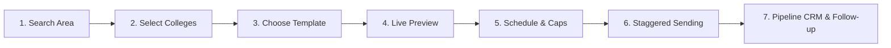

# College Outreach Platform — User Guide

A step-by-step handbook for recruitment coordinators, campus hiring leads, and talent acquisition teams to execute professional, high-deliverability email outreach campaigns across Delhi-NCR higher-education institutions.

---

## 🎯 The Core Outreach Workflow

The platform follows a simple 7-step journey:

---

## 🧭 Navigation & Screen Overview

The platform is organized into 5 primary screens accessible via the top navigation bar:

1. **Overview**: Live operational dashboard showing queue progress, messages sent today, active campaigns, pending follow-ups, and records needing review.
2. **Colleges**: The central directory workspace to search, filter, inspect, and select institutions for outreach campaigns.
3. **Templates**: Reusable email template designer with rich-text editing, personalization placeholders, version history, and live preview.
4. **Campaigns**: Campaign control center to launch, monitor, pause, resume, or review queued messages and delivery outcomes.
5. **Settings**: Default sender identity, default subject line, and SMTP connection test utility.

---

## ⚡ Direct Immediate Email Dispatch (Quick Send)

You can send an email immediately to **any email address** on the spot—without having to add the entity to the directory first!

### How to use Quick Direct Send:
1. Click the **"⚡ Direct Email"** button in the top navigation bar or the **"⚡ Quick Send"** button in the Directory toolbar.
2. Enter the **Recipient Email Address** (e.g. `manager@targetcompany.com`, `contact@gym.in`, or any individual/business).
3. (Optional) Enter the **Recipient Name / Organization** (e.g. `Rohit Sharma` or `Anytime Fitness`).
4. Choose an existing template from your library (which automatically populates the subject line and message body), OR type a custom subject and body.
5. Your sender email and active session password are pre-filled automatically.
6. Click **"🚀 Send Immediately"**.
   - The email is transmitted via SMTP TLS instantly.
   - You receive an immediate delivery acknowledgement.
   - The dispatch is permanently logged to the system's **Outreach Activity Log** for compliance and audit tracking.

---

## 🏫 1. Directory & Category-Based System

The **Directory** tab provides a categorized, searchable inventory of all contacts and institutions across Delhi-NCR.

### Category System (Colleges, Gyms, Offices, Households & Custom)
At the top of the Directory view, you will find interactive category pills with live count badges:
- `🎓 Colleges`: Higher education institutions, universities, and technical campuses with verified placement contacts.
- `🏋️ Gyms`: Fitness centers, gyms, and sports clubs.
- `🏢 Offices`: Corporate workplaces, commercial offices, and tech companies.
- `🏠 Households`: Residential societies, RWAs, and individual community contacts.
- `🌐 All`: Comprehensive view across all categories combined.

#### Switching Categories:
Clicking any category pill (e.g., **"Gyms"** or **"Colleges"**) immediately filters the workspace to display only entities belonging to that category, along with their names, contact persons, emails, phone numbers, and localities.

#### Creating New Categories:
Click **"+ New Category"** in the category bar to create any custom category on the fly (e.g. *Hospitals*, *Co-working Spaces*, *Startups*, *Consultants*). Once created, the new category pill appears in the bar immediately.

#### Adding Contacts to Any Category:
Click **"+ Add Contact / Entity"** to open the creation dialog. Select your desired category from the dropdown (or it will default to your currently active category tab), enter the entity name, contact email, phone, city, address, and notes, and click **Save**.

### Search and Multi-field Filtering
- **Keyword Search**: Type any entity name, category, acronym, locality, or contact email.
  - *Examples*: Type `"DTU"`, `"Gold's Gym"`, `"TechCorp"`, `"Noida Sector 63"`, `"hr@"`.
- **Geographic Filters**: Filter by NCR regions (`Delhi NCT`, `Noida`, `Greater Noida`, `Ghaziabad`, `Gurugram`).
- **Sendable Status**:
  - `Sendable Only`: Verified active contacts that are not marked "Do Not Contact".
  - `Do Not Contact (DNC)`: Excluded entities that have requested no solicitations.

### Selecting Recipients & Category-Targeted Campaigns
- **Persistent Selection**: Your selections survive filtering and pagination.
- **Select This Page**: Checks the records currently displayed on screen.
- **Select All Matching Results**: Checks every entity matching your active category and filters (e.g. select all 50 Gyms at once).
- **Targeted Campaigns**: Once selected, click **"Create campaign with selected"** in the floating bottom action bar to launch a staggered email campaign specifically targeted to that category!

### Viewing and Editing College Details
Click **"View / Edit"** on any college card to open the detail panel:
- **Contact Info**: View official placement cell email (`TPO_Email`), alternate/general inquiry email, placement head contact name, and public office telephone.
- **Source Verification**: View the exact official website URL where the email was located and the date verified.
- **Recruitment Pipeline**: View and update the institution's hiring stage (*Not Contacted, Contacted, Replied, Meeting Arranged, Partnership Active, Declined*).
- **Follow-up Reminders**: Set a target follow-up date and assign a team member.
- **Outreach Timeline**: Full chronological history of every email dispatched to this college and notes recorded by team members.

---

## 📝 2. Email Templates & Personalization

The **Templates** tab allows you to create reusable, personalized messages.

### Dynamic Placeholders
Use double curly braces to insert college-specific details automatically:
- `{{college_name}}`: Inserts the institution's official title (e.g. *Delhi Technological University*).
- `{{contact_name}}`: Inserts the verified placement coordinator's name. If no individual contact person is known, the system automatically falls back to: `"Training & Placement Officer"`.
- `{{city}}`: Inserts the city (e.g. *Noida* or *Delhi*).
- `{{campus}}`: Inserts the campus name (e.g. *Knowledge Park III*).
- `{{locality}}`: Inserts local area or sector.

### Live Preview & Test Email
- **Select College for Preview**: Choose any college from the dropdown to see how your placeholders resolve in real time.
- **Desktop vs. Mobile View**: Toggle preview mode to inspect responsiveness on mobile screens.
- **Send Test Email**: Enter your personal email address and click "Send Test" to verify SMTP connectivity and view formatting in your inbox before scheduling a campaign.

### Template Versioning
Every time you save modifications to an existing template, the system creates a new version record. If you ever need to restore an earlier draft, click **"History"** and restore any previous version with one click.

---

## 🚀 3. Launching a Staggered Campaign

To prevent your sender domain from triggering spam filters or encountering provider bounce limits, the platform sends messages **individually on a staggered schedule**.

### Creating a Campaign
1. On the **Colleges** tab, select your target institutions and click **"Create campaign with selected"** (or click **"New Campaign"** in the Campaigns tab).
2. Configure Campaign Parameters:
   - **Campaign Name**: e.g., *Campus Drive 2026 — Phase 1 Engineering*.
   - **Sender Account**: Your corporate email (e.g., `hiring@yourcompany.com`).
   - **Sender Password**: Your Google Workspace or Microsoft 365 **App Password** (see [OPERATIONS.md](OPERATIONS.md) for generation steps).
   - **Template**: Choose a saved template from your library.
3. Sending Schedule & Business Hours:
   - **Stagger Interval**: Seconds to pause between each email (recommended: **30 to 45 seconds**).
   - **Hourly Cap**: Maximum emails sent per hour (recommended: **30 to 40 emails/hour**).
   - **Daily Cap**: Maximum emails per day (recommended: **150 to 300 emails/day**).
   - **India Standard Time (IST) Business Hours**: Set your sending window (e.g. **09:00 to 18:00 IST**). If a campaign is running when 18:00 arrives, the background worker automatically pauses and resumes at 09:00 the next morning.
   - **Working Days Only**: Tick this checkbox to automatically pause sending on Saturdays and Sundays.
4. **Final Review & Launch**:
   - The confirmation screen calculates the total sendable recipients, automatically excludes any Do-Not-Contact or invalid addresses, and displays the **estimated total delivery duration** (e.g., *~1 hour 15 minutes*).
   - Click **"Confirm & Queue Campaign"**.

---

## 📊 4. Monitoring Campaigns & Queue Statuses

Once launched, messages enter a durable database queue managed by the background worker:

### Message Status Definitions
- 🟡 **`queued`**: Waiting in line to be dispatched according to the interval and rate cap.
- 🔵 **`sending`**: Currently being formatted and transmitted over secure SMTP TLS.
- 🟢 **`accepted`**: Successfully received and acknowledged by the recipient college's mail server (recorded as *"Accepted by provider"*).
- 🔴 **`failed`**: Transmission rejected by the remote server (e.g. invalid mailbox or DNS timeout).
- 🟠 **`needs_review`**: Transmission outcome uncertain (e.g., network dropped during handshake, or application was restarted while sending). Requires manual check before retrying.
- ⚪ **`cancelled`**: Suppressed from sending because the college replied, was placed on DNC, or the campaign was manually cancelled.

### Campaign Controls
- **Pause Campaign**: Temporarily stops new dispatches. In-progress messages finish cleanly.
- **Resume Campaign**: Restarts sending queued messages from where it left off.
- **Cancel Campaign**: Cancels all remaining queued messages in this campaign.
- **Retry Failed**: Resets failed or needs-review messages back to `queued` status for another attempt.

---

## 🤝 5. Recruitment Pipeline CRM & Follow-Up Tracking

Outreach does not end with sending an email. The platform includes a full CRM to manage recruitment partnerships.

### The 6 Recruitment Stages
1. **Not Contacted**: Initial directory state.
2. **Contacted**: At least one campaign or outreach email has been accepted by their server.
3. **Replied**: College TPO or department head has sent a response.
4. **Meeting Arranged**: A phone call, virtual meeting, or campus visit is scheduled.
5. **Partnership Active**: Active hiring agreement, MOU, or campus drive scheduled.
6. **Declined / Inactive**: Institution is currently not accepting hiring partnerships.

### Recording Replies & Automatic Suppression
When an institution replies to your outreach:
1. Open the college detail panel and click **"Record Reply"**.
2. Enter the response summary (e.g., *"TPO Dr. Sharma replied: Interested in 2026 B.Tech batch hiring drive. Requested job descriptions."*).
3. Set the recruitment stage to **"Replied"** or **"Meeting Arranged"**.
4. Set a **Follow-Up Date** and assign an owner.
5. **Auto-Suppression**: The system will **automatically cancel any queued follow-up emails** pending for this college across all active campaigns to prevent awkward duplicate outreach!

### 14-Day Duplicate Outreach Warnings
If a college was contacted within the last 14 days, the platform alerts you with a warning badge on their card to prevent overlapping campaigns from bombarding the same placement cell.

---

## 📥 6. Exporting Data & Multi-Tab Google Sheets / Excel Sync

The platform features automated **multi-tab spreadsheet synchronization** so all categories are organized in a single unified Google Sheet / Excel workbook:

- **📊 Multi-Tab Google Sheet / Excel Workbook (`/api/export/sheets` or `/export.xlsx`)**:
  - Click **"📊 Export Google Sheet / Excel (Multi-Tab)"** in the toolbar or Category bar to download `delhi_ncr_directory_categories.xlsx`.
  - **Individual Tabs Per Category**: The workbook opens with an **Overview & Categories** executive summary, followed by a **dedicated worksheet (tab) for each category** (`Colleges`, `Gyms`, `Offices`, `Households`, plus any custom categories you create).
  - **Automatic Tab Creation**: Whenever you create a new category (e.g. `Schools`, `Hospitals`, `Clinics`), a separate tab is automatically generated for it inside the spreadsheet.
  - **Automatic Contact Placement**: All data collected, edited, or sent under a specific category is automatically routed and populated directly into its respective category tab.
  - **Google Sheets Upload**: In Google Sheets, simply select **File → Import → Upload** (or drag & drop the `.xlsx` file into Google Drive). Google Sheets preserves all category tabs along the bottom bar with styled headers, frozen top rows, and full filterability.
- **📥 Current Category CSV**:
  - Click **"Current Category CSV"** to export only the records from your currently active tab into a standalone CSV.
- **📥 Export Pipeline Summary (`/api/export/pipeline`)**:
  - Download all institutions with their active recruitment stage, assigned recruiter, follow-up dates, and last contact timestamps.
- **📥 Export Outreach History (`/api/export/outreach`)**:
  - Download an audit trail of every email ever dispatched, including recipient email, subject line, timestamp, and provider status.
- **📥 Export Campaign Report (`/api/export/campaign?id=...`)**:
  - On any completed or active campaign, click **"Export Campaign CSV"** to get a per-college breakdown of dispatches, errors, and delivery times.
